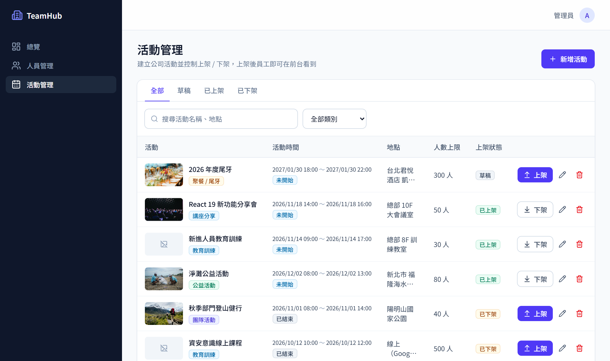
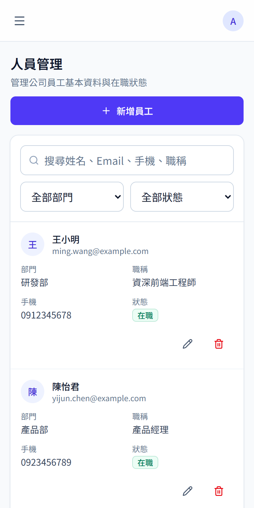
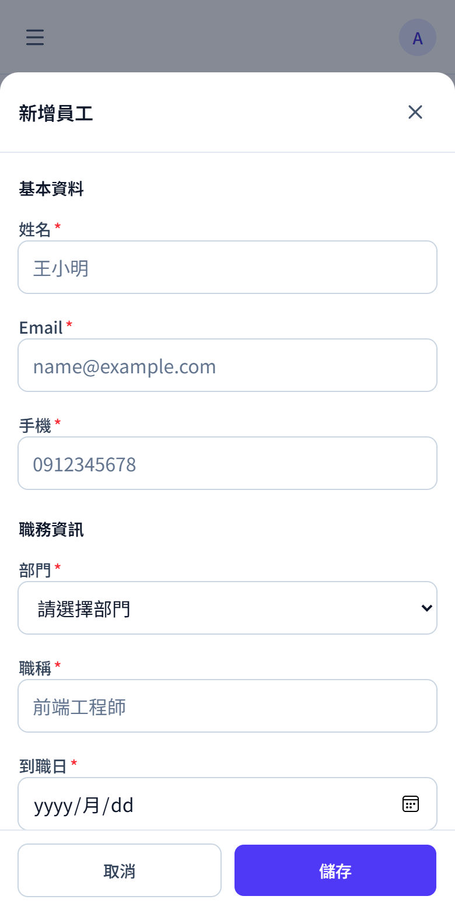
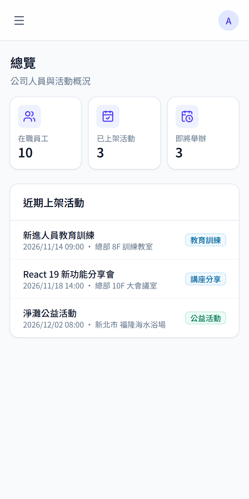
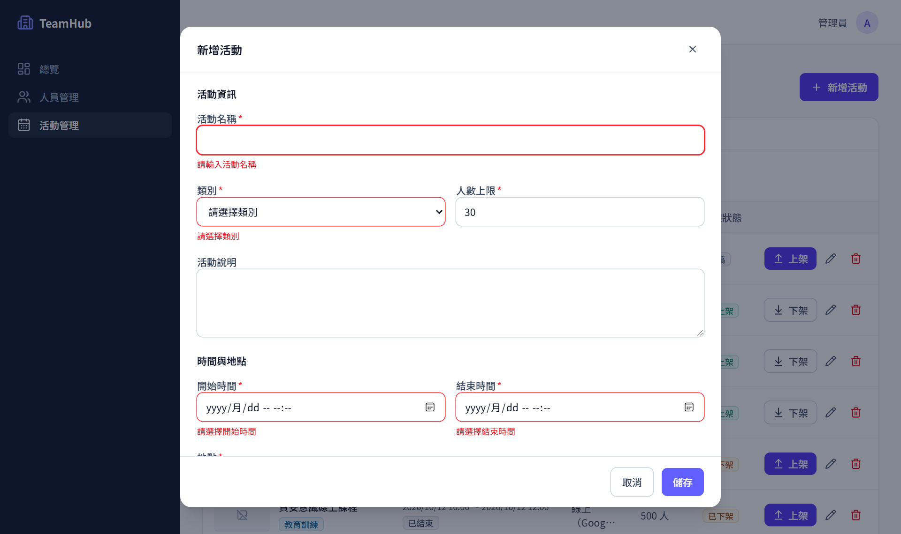

# TeamHub 企業管理後台

[](https://github.com/Ivan5788/teamhub-admin/actions/workflows/ci.yml)


公司內部使用的人員與活動管理後台：管理員工資料、建立公司活動，並控制活動上架或下架。桌面和手機都能完整操作。

### 🔗 線上 Demo：**[teamhub-admin.vercel.app](https://teamhub-admin.vercel.app/)**

在登入頁選一個示範角色就能直接進入，不用輸入帳密。資料存在你自己的瀏覽器裡，可以隨意新增、編輯、刪除，不會影響其他人。

| 角色 | 可以做的事 |
| --- | --- |
| 管理員 | 新增、編輯、刪除所有資料 |
| 編輯者 | 新增與編輯，不能刪除 |
| 檢視者 | 只能瀏覽 |



<table>
  <tr>
    <td width="33%"></td>
    <td width="33%"></td>
    <td width="33%"></td>
  </tr>
  <tr>
    <td align="center">手機版列表改用卡片</td>
    <td align="center">表單從底部滑出</td>
    <td align="center">總覽</td>
  </tr>
</table>

---

## 功能

- **人員管理**：員工資料的新增、編輯、刪除，可依姓名、Email、手機、職稱搜尋，並依部門與在職狀態篩選。
- **活動管理**：建立活動並一鍵上架或下架（樂觀更新，按下立即反映），依時間自動標示「未開始／進行中／已結束」，支援封面圖預覽。
- **登入與角色權限**：三種角色看到的操作不同，未登入會導向登入頁，登入後回到原本的網址。
- **總覽**：在職人數、已上架與即將舉辦的活動統計，點擊直接進入對應列表。
- 搜尋、篩選、分頁都記錄在網址上，重新整理或分享連結都會保留目前的檢視。

## 技術亮點

### 權限三層把關，不只是隱藏按鈕

以 RBAC（角色 → 權限）定義權限，例如 `employees:delete`，並在三個地方檢查：

1. **路由守衛**：未登入或登入過期時導向登入頁，並記住原本的網址；`redirect` 參數只接受站內路徑，防止開放式重新導向。
2. **畫面**：`useAuth().can('employees:delete')` 決定按鈕是否出現；檢視者會看到唯讀提示。
3. **API 層**：MSW 模擬伺服器檢查 `Authorization` header，未登入回 401、權限不足回 403。即使繞過畫面直接呼叫 API 也會被擋下；串接真實後端時，401 會自動登出並導回登入頁。

登入狀態用 `useSyncExternalStore` 訂閱，其他分頁登出時這個分頁也會同步登出；登出時清空資料快取，換帳號不會看到上一位使用者的資料。

### 用 MSW 在網路層模擬後端

Demo 不需要後端，但前端程式碼**沒有任何「假資料分支」**：所有請求都是真的 `fetch`，由 MSW（Mock Service Worker）在網路層攔截並回應。所以：

- 從 Demo 切換到真實後端只要改一個環境變數，頁面、hooks、API 層都不用動。
- 模擬伺服器的行為貼近真實後端：RESTful 路由、分頁與篩選、Bearer token 驗證、401／403、404、409（商業規則衝突）、網路延遲。
- 可以在 Console 設定 `mock:errorRate` 讓請求隨機失敗、`mock:latency` 調整延遲，實際檢查錯誤處理與 loading 狀態。
- 單元測試（Node）與瀏覽器 Demo 共用同一套 handlers，測試走的是和使用者一樣的 HTTP 路徑。

### 新增一個 CRUD 模組只要約 10 行 API 程式碼

`createResourceApi` 和 `createResourceHooks` 兩個工廠函式，從同一份型別產生列表、查詢、新增、修改、刪除的 API 與 React Query hooks。快取失效、成功或失敗提示都統一處理，頁面元件不需要寫任何 `useEffect` 打 API。

```ts
export const eventApi = createResourceApi<CompanyEvent>({
  resource: 'events',
  mock: { seed: eventSeed, searchFields: ['title', 'location', 'description'] },
})
export const eventHooks = createResourceHooks('events', eventApi, '活動')
```

### 模組邊界由 Lint 強制，而不是靠口頭約定

架構規則寫在 [`.oxlintrc.json`](.oxlintrc.json) 裡，CI 會擋下違規：

- 業務模組之間只能透過各自的 `index.ts` 互相引用。
- 共用層（`components`、`hooks`、`lib`）不能依賴業務模組，相依方向只能是 `features → 共用層`。
- 業務模組不能直接呼叫 `fetch`，頁面元件也不能直接呼叫 API，一律透過 hooks。

### 表單體驗

- 驗證規則只用 Zod 寫一次，同時產生 TypeScript 型別。輸入時即時檢查，儲存時如果還有錯誤，視窗會輕微震動提示。
- 跨欄位驗證（結束時間必須晚於開始時間），只在兩個欄位都填好時才觸發，不會提早跳出錯誤。
- 有未儲存的修改時，按取消、點背景或按 Esc 都會先詢問，避免誤關遺失資料。



### 樂觀更新與失敗還原

上架／下架不等 API 回應就先更新畫面，失敗時自動還原並提示。實作放在通用的 `useUpdate({ optimistic: true })`，任何模組都能用：先暫存快取快照、套用變更，失敗時還原，最後一律重新抓取，確保與伺服器一致（例如在「已上架」篩選下取消上架，該筆會正確消失）。

### 中文輸入法相容

搜尋框原本會在注音選字過程中就寫入網址並觸發查詢，打「ㄨㄤ」會變成「ㄨㄨㄤㄤ」。現在輸入框保留自己的草稿狀態，等選字結束（`compositionend`）才在 300ms 後同步到網址，並有測試覆蓋這個情境。

### 行動版不是「縮小的桌面版」

- 欄位定義加一個 `mobile` 屬性，同一份設定可以渲染成表格或卡片，新模組不必另外寫手機版。
- 切換依據是**表格實際可用的寬度**（ResizeObserver），不是螢幕寬度。平板、或有側邊欄的小筆電放不下表格時也會改用卡片，不會被切掉；寬卡片會把資料攤成一排。
- 表單在手機上改成底部面板，標題與「取消／儲存」固定，只捲動欄位區，並避開 iPhone 底部的安全區域。
- 觸控目標至少 44px；輸入框字級 16px，避免 iOS 點擊時自動放大；觸控裝置開啟表單時不自動彈出鍵盤；手機欄位叫出數字鍵盤。

### 無障礙與細節

- 對話框有焦點鎖定，關閉後焦點回到原本的按鈕；手機選單收合時設為 `inert`，Tab 不會走進看不見的連結。
- 鍵盤操作時有清楚的焦點樣式；動畫遵守系統的「減少動態效果」設定。
- 載入時顯示骨架畫面；查無資料時提供「清除搜尋與篩選」或「新增」的下一步。
- 頁面依路由延遲載入，路由層級有錯誤頁，單頁出錯不會讓整個應用程式白畫面。

## 技術選型

| 用途 | 選擇 | 理由 |
| --- | --- | --- |
| 框架 | React 19 + TypeScript | 嚴格型別，表單、API、欄位定義共用同一份型別 |
| 建置 | Vite | 開發伺服器啟動與熱更新快 |
| 路由 | React Router v7 | 延遲載入路由、路由層級錯誤處理 |
| 伺服器狀態 | TanStack Query | 快取、重新抓取、loading 與錯誤狀態交給函式庫，不手寫 `useEffect` |
| 表單 | React Hook Form + Zod | 非受控輸入效能好；驗證規則與型別只寫一次 |
| 樣式 | Tailwind CSS v4 | 設計 token 集中在 `@theme`，響應式與狀態樣式寫在元件旁 |
| Lint | Oxlint | typescript-eslint 尚未支援 TypeScript 7；Oxlint 速度快，且足以表達模組邊界規則 |
| 測試 | Vitest + Testing Library | 以使用者操作的角度測試元件，不測實作細節 |
| API 模擬 | MSW | 在網路層攔截請求，前端程式碼與串接真實後端時完全相同；測試與 Demo 共用 |
| 端對端測試 | Playwright | 真實瀏覽器驗證完整流程，可模擬手機裝置與輸入法 |

## 架構

```
頁面元件
  │  eventHooks.useList(params)          讀取
  │  eventHooks.useCreate().mutate()     寫入：成功後自動刷新列表並顯示提示
  ▼
createResourceHooks                      React Query 包裝
  ▼
ResourceApi（list / get / create / update / remove）
  ▼
http()                                   fetch 封裝：帶上 token、統一錯誤格式、401 自動登出
  ▼
網路請求 GET /api/events?page=1&status=published
  ├─ Demo（預設）  MSW 攔截，模擬伺服器回應，資料存在 localStorage
  └─ 正式環境      VITE_USE_MOCK=false，送到真實後端
```

前端只有一條資料路徑，切換環境變數就能從模擬伺服器改接真實後端。API 格式請見[開發指南](docs/DEVELOPMENT.md#串接真實後端)。

```
src/
├── app/            應用程式外殼：Provider、路由、錯誤頁
├── components/     共用 UI（ui/）、表格（data-table/）、版面（layout/）
├── hooks/          跨模組共用的 hooks（列表網址狀態、RWD 判斷…）
├── lib/            API 層、登入與權限（auth/）、React Query 工廠、工具函式
└── features/       業務模組：auth（登入頁）、employees、events、dashboard
```

## 品質保證

- **單元與元件測試**：Vitest + Testing Library，透過 MSW 走真實的 HTTP 路徑，涵蓋模擬伺服器的查詢與 409 規則、角色權限矩陣、API 層 401／403、登入導回與 redirect 安全性、表單驗證、震動提示、中文輸入法、列表網址狀態、卡片版型切換、樂觀更新與失敗還原等情境。
- **端對端測試**：Playwright 對打包後的正式版本跑真實瀏覽器，包含桌面與手機裝置，涵蓋伺服器錯誤與重新載入、登入導向、三種角色的權限、登出、新增、編輯、刪除、未儲存提醒、網址狀態、注音選字（以 CDP 模擬輸入法）、樂觀更新與手機版版面。
- **CI**：每次推送都會在 GitHub Actions 跑 lint、型別檢查、單元測試、打包與端對端測試，失敗時上傳 Playwright 報告。
- **部署**：推送到 `main` 後由 Vercel 自動部署，並設定 SPA 路由回退與靜態資源長期快取。

## 本機執行

需要 Node.js 22 以上。

```bash
npm install
npm run dev         # http://localhost:5173
npm test            # 單元與元件測試
npm run e2e         # 端對端測試（第一次需先執行 npx playwright install chromium）
npm run lint        # Oxlint，含模組邊界規則
npm run typecheck   # 型別檢查
npm run build       # 型別檢查 + 打包
```

預設由 MSW 模擬伺服器回應，不需要後端。在瀏覽器 Console 可以調整模擬行為（設定後重新整理）：

```js
localStorage.setItem('mock:latency', '2000')  // 每個請求延遲 2 秒
localStorage.setItem('mock:errorRate', '0.3') // 30% 的請求回傳 500
```

想還原初始資料：開發者工具 → Application → Local Storage → 刪除 `mock:` 開頭的項目。

新增模組的步驟、資料夾慣例與常見任務，請見 **[開發指南](docs/DEVELOPMENT.md)**。

## 接下來的規劃

- [ ] 員工報名活動與名額控管
